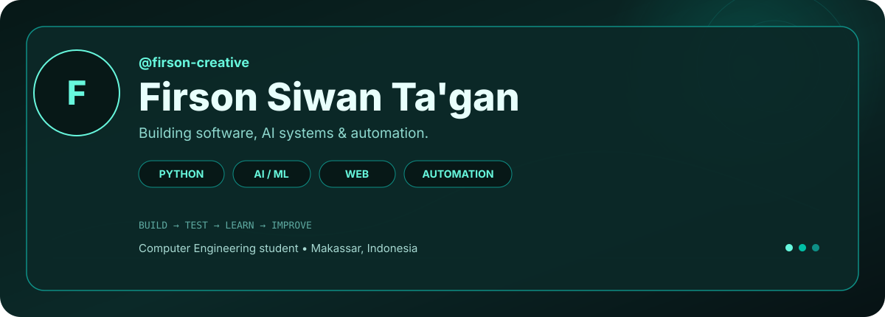
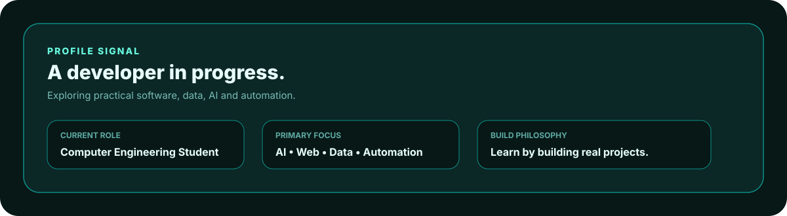
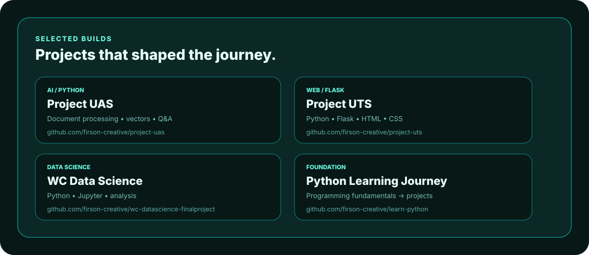
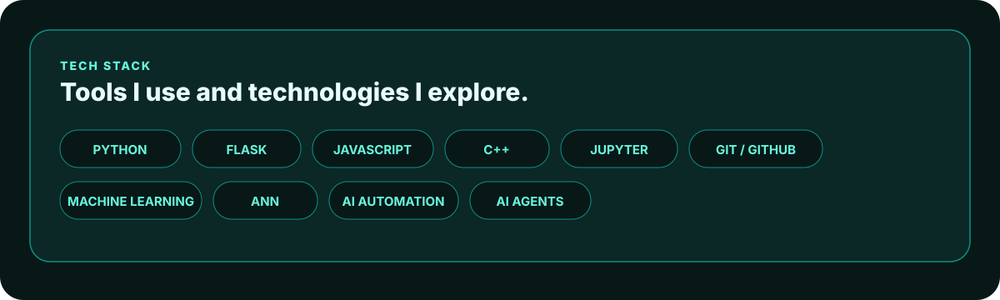
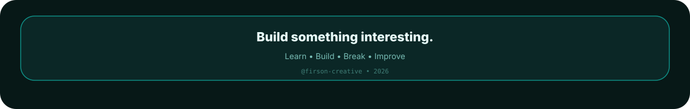

<!--
  FIRSON-CREATIVE
  Dark Futuristic / Teal Glassmorphism Profile
-->

<div align="center">



<br><br>



</div>

---

<div align="center">

## `01` — THE BUILD LOG


<sub>Every contribution is another build, experiment, lesson, or improvement.</sub>

</div>

<br>

<div align="center">



<br><br>



</div>

---

## `02` — CURRENTLY BUILDING

```text
AI / ML
├── Artificial Neural Networks
├── Machine Learning
├── Data preprocessing
└── AI applications

SOFTWARE
├── Python
├── Flask
├── JavaScript
└── Git / GitHub

AUTOMATION
├── AI agents
├── Multi-model workflows
├── Prompt engineering
└── Developer automation
```

## `03` — DEVELOPMENT PATH

```text
Programming
      │
      ▼
Web Development
      │
      ▼
Data & Data Science
      │
      ▼
Artificial Intelligence
      │
      ▼
AI Engineering
      │
      ▼
Automation & AI Agents
```

<details>
<summary><b>More about my journey</b></summary>

I started by building programming fundamentals and small academic projects, then moved into web development, data science, and AI-oriented projects.

The goal is not only to learn individual technologies, but to understand how they can work together to solve practical problems.

</details>

---

<div align="center">



</div>
